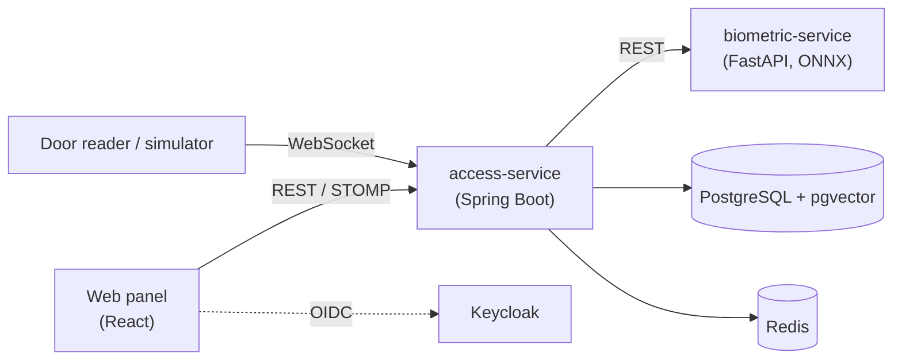

# face-access-system

**Spoof-resistant face recognition access control system** – a research platform for measuring how well layered defences protect face recognition against presentation attacks (printed photos, screens, masks) and injection attacks (virtual cameras, forged frames, session replay).

> Status: early development – phase 1 ("backbone"). Built as part of a master's thesis.

## Overview

A low-cost door reader (Raspberry Pi Zero 2 W with a NoIR camera and a presence radar) acts as a thin client. All decisions are made server-side:

- **access-service** – Java 25, Spring Boot 4: sessions, policies, decisions, audit log, OAuth2 (Keycloak) via BFF.
- **biometric-service** – Python 3.12, FastAPI, ONNX Runtime: face detection and recognition (classical LBP and neural SFace), liveness detection, active challenge.
- **web panel** – React, TypeScript, Vite: users, face enrolment, live view of access attempts.
- **data** – PostgreSQL with pgvector, Redis, S3-compatible object storage for experiment recordings.



## Research

The study compares recognition variants (classical **K** vs neural **S**) combined with defence layers (none, passive liveness **P**, liveness + active challenge **W**), reporting APCER/BPCER (ISO/IEC 30107-3), FAR/FRR and the latency cost of each layer.

## Repository layout (planned)

```
device/                       door reader and simulator
web/                          admin panel
services/access-service/      Java / Spring Boot
services/biometric-service/   Python / FastAPI
deploy/                       Docker Compose, later Helm
experiments/                  experiment definitions and analysis
docs/                         system documentation (MkDocs)
```

## Getting started

Prerequisites: Docker with Docker Compose, Java 25, Python 3.12 with [uv](https://docs.astral.sh/uv/), Node.js LTS. Run instructions will be added together with the first runnable service.

## Data and privacy

This repository never contains biometric data, recordings, datasets, secrets or model weights with restricted licences. Models are listed in a model registry with their source and licence.

## License

[Apache License 2.0](LICENSE)
